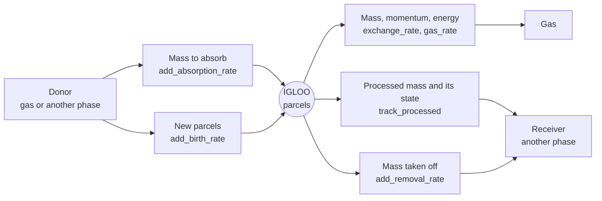
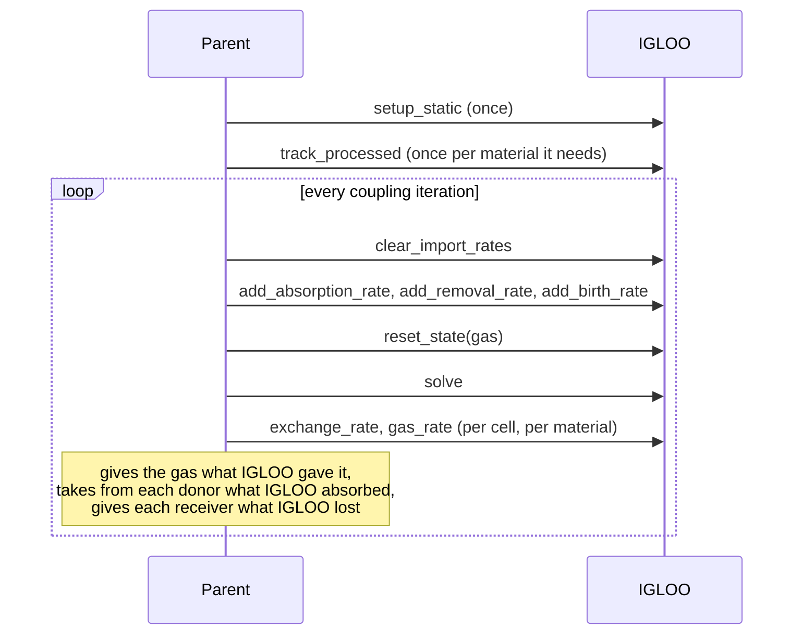
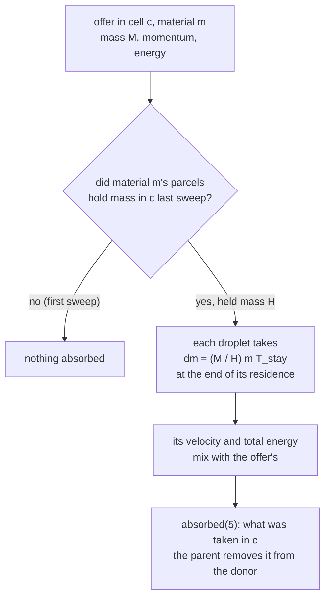

# Coupling with other solvers

IGLOO tracks parcels through a gas it does not change. A parent code (hydra, for one) couples it to the gas and to
other phases. Everything the parent sends to IGLOO or reads from it goes through one module,
`src/lib/coupling/IGLOO_Mod_Exchange.f90`, besides the `obj_IGLOO` sweep calls. The parent never reads IGLOO's
arrays itself.

---

## The channels at a glance



Read it left to right: what comes into the parcels, then what leaves them. The carried material a burning drop
deposits on itself, and gives up at burnout, stays inside the parcels; `exchange_rate` reports it too.

| Direction | Channel | Call |
| :--- | :--- | :--- |
| IGLOO → gas | the mass each material gives the gas (evaporation, burning), net | `exchange_rate` |
| IGLOO → gas | the momentum and energy all parcels give the gas | `gas_rate` |
| within a parcel | the carried material the burning deposits on the parcels, and the carried material they give up at burnout | `exchange_rate` |
| IGLOO → any phase | the mass the process takes off a material, with the velocity and temperature it leaves at | `track_processed`, then `exchange_rate` |
| any phase → IGLOO | mass offered to the parcels of a material in a cell; they absorb it | `add_absorption_rate`, `absorption_packet` |
| any phase → IGLOO | new parcels of a material born in a cell | `add_birth_rate` |
| IGLOO → any phase | mass taken off the parcels of a material in a cell, as whole droplets | `add_removal_rate`, then `exchange_rate` |

All rates are per second and per cell, the cell's total (no volume factor): kg/s, N, W.

---

## A coupling sweep



Offers and births stay until `clear_import_rates`: a parent that sets them again every iteration clears them first.

---

## What a coupler reads

`exchange_rate(igloo, m, b, i, j, k)` returns material `m`'s exchange in geometry cell `(i, j, k)` of block `b`:

| Field | Unit | Meaning |
| :--- | :--- | :--- |
| `mass` | kg/s | the mass the parcels give the gas, net |
| `carried_in` | kg/s | the carried material the burning deposited on the parcels |
| `carried_out` | kg/s | the carried material the parcels gave the gas when they burnt out |
| `processed` | kg/s | the mass the process (burning, evaporation) took off the parcels, when the material is tracked |
| `tracked`, `u`, `T` | –, m/s, K | the velocity and temperature the processed mass left at, weighted by the mass processed |
| `absorbed(5)` | kg/s, N, W | what the parcels absorbed: mass, momentum (3), energy |
| `removed(5)` | kg/s, N, W | what a removal took off the parcels: mass, momentum (3), energy |

`gas_rate(igloo, b, i, j, k)` returns the momentum (1:3) and energy (4) all parcels gave the gas in the cell.

For a burning drop that carries what it forms, the metal burnt in the cell is
`mass + carried_in - carried_out` ([Rows of the mass source](../theory/eulerian-feedback.md#rows-of-the-mass-source)).
What the parcels absorbed is not in `mass`, `gas_rate` or the gas's books: it came from the donor. Nor is what a
removal took off them: it goes to the receiver.

### The state of the processed mass

A coupler that turns the processed mass into something else (the smoke of a burning drop in an Eulerian solver,
the vapour of an evaporating one) needs the state it leaves at. `track_processed(igloo, m, why)` asks for it, from
the next sweep on. IGLOO then weights the parcels' velocity and temperature by the mass processed over each cell
residence, step by step. The new phase is the coupler's. IGLOO holds one of its constants for it: `d-gen` of the
material's combustion row, the diameter the generated drops are born with, which `gen_diameter(igloo, m)` returns
(0 when the row gives none). IGLOO itself does not use it.

---

## Receiving mass

Mass can come to IGLOO's parcels from the gas (condensation) or from any other phase (collection). It enters in
one of two ways.

### Absorbed by the parcels in a cell



A parcel absorbs its share of the offer: the part of the mass its material held in the cell during the last sweep.
A droplet of mass $m$ that stays $T_\mathrm{stay}$ in the cell takes

$$
\delta m = \frac{M}{H}\,m\,T_\mathrm{stay},
$$

with $M$ the mass offered per second and $H$ the mass the material held there last sweep. Summed over the parcels
this is $M$ once the held mass settles; the first sweep after an offer absorbs nothing, and the next ones converge
to the offer in a few sweeps (the suite measures 3 % off at the second sweep and 0.06 % at the third). The droplet's
velocity and total energy mix with the offer's, so mass, momentum and energy are conserved exactly:

$$
\mathbf u' = \frac{m\,\mathbf u + \delta m\,\mathbf u_\mathrm{in}}{m + \delta m}, \qquad
h' + \tfrac12|\mathbf u'|^2 = \frac{m\,(h + \tfrac12|\mathbf u|^2) + \delta m\,e_\mathrm{in}}{m + \delta m}.
$$

`absorption_packet(igloo, m, mass, u, T)` builds the offer $[M, M\mathbf u, M e_\mathrm{in}]$ in material `m`'s own
enthalpy datum. The absorbed amounts are kept per geometry cell, apart from the smoothed source fields, so the
parent removes from each donor cell exactly what was taken there.

Parcels that can absorb: inert drops (model 1), evaporating drops (models 2, 4) and burning drops (model 5). The
call refuses, in plain words, a material whose parcels keep a fixed mass (breakup without evaporation, model 3),
freeze (models 6, 7) or carry a second material (model 8).

### Born as new parcels

`add_birth_rate(igloo, m, b, i, j, k, mass, u, T, d, why)` adds one stream of new parcels of material `m`, born at
the centre of the cell with velocity `u`, temperature `T` and diameter `d`. Births go to a **born-only** material:
a line of the phase file with no injection groups. Such a line also holds the burnout residues of a drop that
carries it ([The burnout residue](../theory/combustion.md#the-burnout-residue)); births come after the residues
(their IDs follow), and are integrated after every injected material.

---

## Taking mass off the parcels

`add_removal_rate(igloo, m, b, i, j, k, mass, why)` takes `mass` [kg/s] off the parcels of material `m` in a cell,
for the gas or for any other phase (a transfer to an Eulerian solver, for instance). It works as absorption does, in
reverse. Each parcel gives up its share: a fraction

$$
f = \frac{M}{H}\,T_\mathrm{stay}
$$

of its droplets, at the end of its residence, with $M$ the mass asked per second and $H$ the mass the material held
in the cell last sweep. The droplets leave whole, at their own velocity and temperature, so the droplets left are
unchanged: only the parcel's number and mass flux drop by $f$. A parcel whose share reaches all of it leaves the run.
The first sweep after a request takes nothing, and the next ones converge to it as absorption does.

`exchange_rate`'s `removed(5)` reports what left, per geometry cell: the coupler gives it to the receiver. Every
model can lose droplets this way, since a removal changes no droplet's state. Requests add up until
`clear_import_rates`.

---

## Refusals

Every setter returns `why`: empty when accepted, otherwise the reason in plain words, and nothing changes. For
instance:

| Call | Refused when |
| :--- | :--- |
| `track_processed` | the material neither burns nor evaporates |
| `add_absorption_rate` | the cell is outside its block, the mass is not positive, or the parcels cannot absorb (above) |
| `add_removal_rate` | the cell is outside its block, or the mass is not positive |
| `add_birth_rate` | the material is injected, breaks up into children, or the mass, diameter or temperature is not positive |

---

## A minimal coupler

```fortran
use IGLOO_module,       only: obj_IGLOO
use IGLOO_Mod_Exchange, only: exchange_t, material_id, exchange_rate, gas_rate, &
                              absorption_packet, add_absorption_rate, clear_import_rates

type(obj_IGLOO)  :: igloo
type(exchange_t) :: x
character(len=:), allocatable :: why
integer :: m

call igloo%setup_static(gas)
m = material_id(igloo, 'AL')
do iteration = 1, n
  call clear_import_rates(igloo)
  call add_absorption_rate(igloo, m, b, i, j, k, absorption_packet(igloo, m, 1.e-6_R8, u, T), why)
  call igloo%reset_state(gas)
  call igloo%solve()
  x = exchange_rate(igloo, m, b, i, j, k)   ! x%mass to the gas, x%absorbed(1) from the donor
enddo
```

The suite drives these calls the same way: `tests/coupling/test_exchange.f90`
([Coupling & Outputs](../vv/coupling.md#exchange-channels)).
