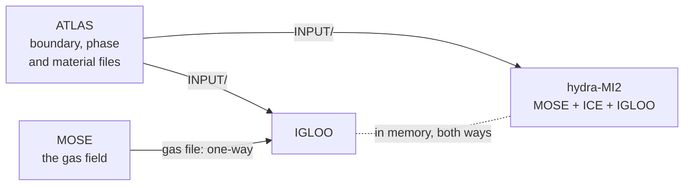

# Getting Started

IGLOO (**I**ntegration of a **G**eneral **L**agrangian **O**ne-way **O**DE set) is an open-source Lagrangian particle
solver written in modern Fortran. It integrates each parcel's state — position, velocity, temperature, diameter —
through a *steady* gas field, sweeping every parcel from injection to its exit from the domain in a single pass. The
gas field is read from a file, or passed in memory by a coupler. Drag and heat transfer are always integrated;
evaporation, breakup, combustion, solidification and the feedback to the gas are switched on per case.

!!! info "IGLOO within Hydra"
    IGLOO is the Lagrangian solver of the dispersed phase in the **Hydra** suite. The pre-processor **ATLAS** writes
    the boundary and material files IGLOO reads, and **hydra-MI2** couples it with the gas and with ICE
    ([Hydra Suite](#hydra-suite)).

-   :material-download:{ .lg .middle } __Installation__

    ---

    Build IGLOO from source — standalone or as a hydra submodule

    [:octicons-arrow-right-24: Install IGLOO](installation.md)

-   :material-rocket-launch:{ .lg .middle } __Quick Start__

    ---

    Run the Stokes-drag verification case end to end in minutes

    [:octicons-arrow-right-24: Quick start tutorial](quick-start.md)

## Scope of This Section

1. **Installation** — prerequisites, standalone and hydra-submodule builds, incremental rebuild.
2. **Quick Start** — run one oracle-checked case (`drag-stokes`) end to end and check its result.

Then the [User Guide](../user/index.md) explains how to set up a case, and [Input Files](../user/input.md) where each
model is switched on.

---

## Hydra Suite

**Hydra** composes focused solvers into coupled multi-physics simulations: compressible flows, heat conduction in
solids, radiation and dispersed phases. Each solver is a library with its own repository, documentation and tests;
hydra builds them as submodules and runs them through its `figaro` command line.

| Component | Role |
|-----------|------|
| [**ATLAS**](https://github.com/open-hydra/ATLAS) | Pre-processor: grids, initial and boundary conditions, the phase and material tables of every solver |
| [**MOSE**](https://github.com/open-hydra/MOSE) | Compressible Euler and Navier–Stokes: RANS turbulence, finite-rate chemistry, soot |
| [**ARES**](https://github.com/open-hydra/ARES) | Real-fluid dynamics |
| [**FUSS**](https://github.com/open-hydra/FUSS) | Heat conduction in solids, steady and transient |
| [**GROOT**](https://github.com/open-hydra/GROOT) | Radiative heat transfer |
| [**ICE**](https://github.com/open-hydra/ICE) | Dispersed condensed phase, Eulerian moment closures |
| **IGLOO** | Dispersed condensed phase, Lagrangian parcels — *this package* |

Hydra links the solvers into coupled executables. Some examples:

| Executable | Solvers | Use |
|------------|---------|-----|
| `hydra-MF` | MOSE + FUSS | conjugate heat transfer, compressible fluid and solid |
| `hydra-MI2` | MOSE + ICE + IGLOO | two-phase flow: a compressible gas with Eulerian and Lagrangian dispersed phases |

A typical workflow:

1. **ATLAS** writes `INPUT/bc.txt`, `INPUT/phase.txt`, `INPUT/models.txt` and `INPUT/properties.dat`.
2. **MOSE** (or another gas solver) computes the steady gas field and writes it as a Tecplot file.
3. **IGLOO** reads that field as a frozen background, injects the parcels and integrates them through the domain:
   one-way coupling.

Inside **hydra-MI2** the gas comes in memory instead, and IGLOO's parcels give it back mass, momentum and energy; the
exchange is described in [Coupling](../development/coupling.md).

!!! info "Using IGLOO without ATLAS"
    ATLAS is the standard way to write the boundary and material files. Without it, every file can be written by
    hand; the formats are in the [User Guide](../user/using.md).

---

## Capabilities

| Feature | Details |
|---------|---------|
| **Drag** | 13 correlations: Stokes, Schlichting, Schiller–Naumann, Morsi–Alexander, Wen–Yu, Newton, Chang, Clift–Gauvin, Putnam (incompressible); Henderson, Crowe, Hermsen, Carlson–Hoglund (compressible) |
| **Heat transfer** | Six Nusselt correlations: Ranz–Marshall, Kavanau–Drake, JAXA1–JAXA4; grey-body radiation with the gas temperature (emissivity per material) |
| **Evaporation** | d²-law, CEM, CEM-B, Abramzon–Sirignano and Tonini–Cossali; equilibrium or Langmuir–Knudsen interface; Stefan-blowing reduction; conduction inside the drop and boiling |
| **Combustion** | Beckstead $d^n$ law with ignition, or the direct model; a residue or a burn-out; a carried material (an oxide cap) with its burnout residue |
| **Solidification** | Supercooling, recalescence, freezing and melting with the heat of fusion |
| **Breakup** | Five models (Pilch–Erdman, Reitz–Diwakar, Reitz-KHRT, TAB, ETAB); KHRT child parcels |
| **Injection** | Boundary-patch injection (2-D sweep or 3-D hexagonal packing); assigned positions; diameter distributions (Dirac, Normal, LogNormal, Rosin–Rammler) and tabulated ones |
| **Feedback to the gas** | Parcel statistics deposited on the gas mesh as Eulerian and source fields, smoothed by a binomial mollifier |
| **Coupling** | One interface for a coupler: the gas state, the exchange rates, absorbed and born mass ([Coupling](../development/coupling.md)) |
| **ODE integration** | Explicit (DOPRI5) or stiff implicit (H-SDIRK4) stepping through OSLO; cell tracking by ray-face intersection |
| **Parallelism** | OpenMP over parcels; optional MPI over parcels, with output independent of the rank count |
| **I/O** | Tecplot ASCII/binary through ORION; trajectories, Eulerian and source fields, scatter clouds and exit locations |

---

## Dependencies

IGLOO is built on three companion libraries. In a standalone build FiNeR is a Git submodule, and ORION and OSLO are
releases the configure checks out; as a hydra submodule it shares them with the suite.

| Library | Role |
|---------|------|
| [ORION](https://github.com/MarcoGrossi92/ORION) | Multi-format I/O (Tecplot ASCII/binary) |
| [OSLO](https://github.com/MarcoGrossi92/OSLO) | ODE solver library (DOPRI5, H-SDIRK4) |
| [FiNeR](https://github.com/szaghi/FiNeR) | INI configuration file parser |

Optional: **OpenMP** (threads over parcels), **MPI** (ranks over parcels, hybrid with OpenMP), **TecIO** (Tecplot
binary output, pulled in by ORION; not combinable with MPI).
