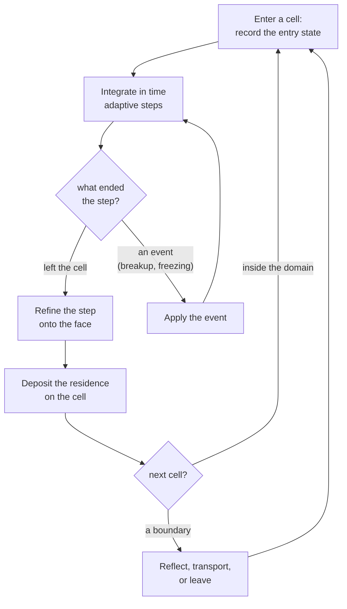

# Time Integration

Each parcel is integrated on its own, from its injection to its exit, independently of every other parcel; the
parcels are shared among threads and processes. Its path is cut into **segments**, one per cell it crosses: the gas,
the deposits and the trajectory output all work cell by cell.

---

## The integrator

Two adaptive integrators are available ([Integrator](../user/solver.md)):

- **SDIRK4** (the default): an L-stable, stiffly accurate, fourth-order diagonally implicit Runge–Kutta method. Small
  drops make the equations stiff: the drag relaxation time $\tau_p = \rho_p d^2/(18\mu_g)$ can be far shorter than the
  time to cross a cell.
- **DOPRI5**: the explicit Dormand–Prince 5(4) method, faster where nothing is stiff (large, inert particles).

The tolerances apply to each state component. The mass of an evaporating or burning drop takes the tighter
$\min(\mathrm{atol}, 10^{-3} m_b)$ by default, $m_b$ the burnout mass: one absolute tolerance over states in kg, m, s and
K gives no control over the mass of a drop lighter than it, and in the last part of its life the solver's trial states
could reach a negative mass.

---

## A segment

1. **Entry.** The parcel's state at the cell entry is recorded: it is what the deposit subtracts from.
2. **Time budget.** The time to cross the cell is estimated from the distance to its exit face along the velocity
   (on the gas dual cell at the second gas order); where it is not finite, a multiple of the Stokes time is used. The
   integration is allowed well past it: the integrator stops at the face.
3. **Integration.** After every accepted step IGLOO checks whether the parcel left its cell (or, at the second gas
   order, its gas dual cell, or the wedge sector), whether an event occurred, and whether the drop is consumed.
4. **Refinement onto the face.** A step that left the cell is taken back and retried with a shorter time, aimed at the
   face by the distance to it, until a step ends just past the face. The step is never shorter than the time to move
   a fraction of the containment tolerance, so the refinement cannot stall. A segment allows a bounded number of
   integrator calls (10 by default); a parcel that needs more ends at its last accepted step.
5. **Deposit.** The residence is deposited on the cell ([Eulerian feedback](eulerian-feedback.md)).
6. **Next cell.** The cell search finds the new cell ([Geometry](geometry.md)), or the boundary acts.
7. **Output.** Trajectory rows and scatter markers are written.

### What happens after each accepted step

- **Scatter cloud.** The parcel accumulates its number rate at entry times the step length, and writes a marker each
  time the sum crosses a multiple of the scatter quantum, at the fraction of the step where it does: the position on
  the cubic through the step's end positions and velocities, the other quantities linear. A step that is cut and
  integrated again counts once.
- **Burnout.** An evaporating or burning drop whose mass reaches the burnout mass $m_b$ is consumed
  ([below](#when-a-parcel-ends)).
- **Breakup events.** TAB, ETAB and KH-RT apply their events between steps; a KH-RT shed starts a new parcel. On a
  freezing material they act only on a liquid step.
- **Freezing events.** The step that ends strictly past the threshold of the current phase (the nucleation
  temperature, a frozen fraction of 0 or 1, the melting temperature) is cut: the state is interpolated linearly to the
  crossing and the phase change applied there, landing inside the new phase. A step that also crosses a face is
  refined first; a threshold passed at the start of a segment is applied there
  ([Solidification](solidification.md#event-location)).

---

## When a parcel ends

A parcel's integration ends when it leaves the domain, at the end time when one is set, or for one of these reasons:

| Reason | What happens |
| :--- | :--- |
| **burnout**: an evaporating or burning drop's mass reaches $m_b = \min(10^{-6} m_0, 10^{-20}\ \mathrm{kg})$ | the drop is consumed; what it carried into the cell goes to the gas (a step that ends below zero mass is set to zero). $m_0$ is the reference mass: at injection, a child's at its birth, a KH-RT drop's at its last RT breakup or KH shed |
| **the integrator fails**, or the state stops being finite | the parcel returns to its last accepted step and is deposited up to it; a consuming drop gives its remnant to the gas, or forms its residue ([The burnout residue](combustion.md#the-burnout-residue)) |
| **too many integrator calls** on one segment | as a failure, with a warning |
| **stuck in a cell**: more than 10 segments in one cell without a crossing (reflections not counted) | dropped, with a message |
| **bouncing in place**: every 100 reflections, closer than 0.1 mm to the previous checkpoint | dropped, with a message |
| **too many reflections** (10 000 by default) | dropped, with a message |
| **too many segments**: 500 000 | dropped, its exit record written |

In the equations, a trial state of the implicit integrator may be unphysical (a negative mass or number rate). Any
right-hand side that is not finite is replaced by a huge value, so the integrator rejects the step instead of carrying
the error on. On a freezing drop there is no clamp on the frozen fraction: the events own its crossings of 0 and 1.
