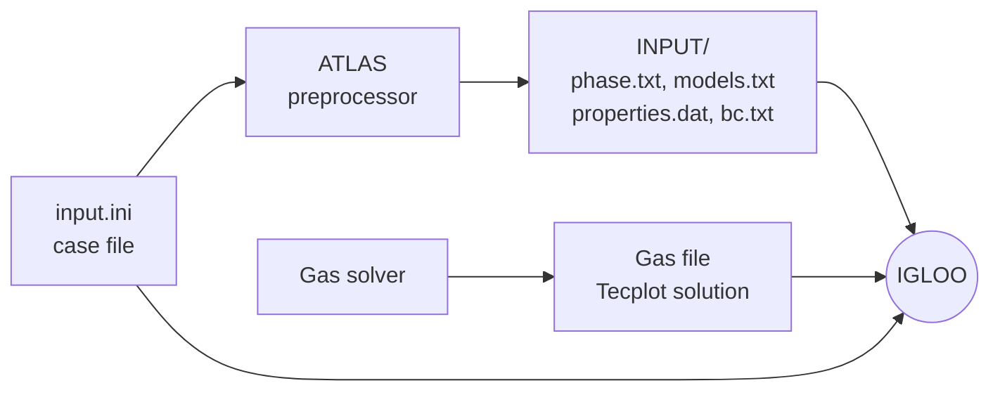

# Input Files

A case gives IGLOO three things: the gas the parcels fly through, the condensed phase (its materials, models,
properties and inlets), and the run settings. ATLAS writes the condensed phase from the case file; another solver
writes the gas.



| File | Holds | Written by | Page |
| :--- | :--- | :--- | :--- |
| `input.ini` | the run settings, in the `[IGLOO-*]` sections | you | this page and the ones below |
| `INPUT/phase.txt` | one line per material: its name, its injection groups and its model words | ATLAS | [Materials & Models](models.md) |
| `INPUT/models.txt` | the constants of the burning and breakup models, one row per material and kind | ATLAS | [Materials & Models](models.md) |
| `INPUT/properties.dat` | the property tables of every material, in temperature | ATLAS | [Material Properties](properties.md) |
| `INPUT/bc.txt` | the boundary code of every boundary face cell, and the inlet data | ATLAS | [Boundary & Injection](boundary-conditions.md) |
| gas file | the gas field on the mesh | the gas solver | [Run Settings](general.md#the-gas-file) |

With a phase name (`[IGLOO-General] phase = <name>`) the four `INPUT/` files take the prefix `<name>-`.

---

## The case file

`input.ini` is an INI file: named sections, one `key = value` per line, `;` starting a comment.

```ini
[SECTION-NAME]
key = value   ; comment
```

A key you leave out takes its default. IGLOO reads only its own sections:

| Section | What it sets | Page |
| :--- | :--- | :--- |
| `[IGLOO-General]` | the gas file, the outputs, run limits, smoothing, gravity | [Run Settings](general.md) |
| `[IGLOO-Models]` | the default models of every material: drag, heat, evaporation, breakup, burning | [Materials & Models](models.md) |
| `[IGLOO-Properties]` | constant properties: evaporation, breakup, emissivity | [Material Properties](properties.md) |
| `[IGLOO-BC]` | how parcels are placed on the inlets | [Boundary & Injection](boundary-conditions.md#placing-the-parcels-igloo-bc) |
| `[IGLOO-ODE]` | the integrator and its tolerances | [Integrator](solver.md) |
| `[IGLOO-Erosion]` | wall erosion (the section's presence turns it on) | [Wall Erosion](erosion.md) |

Every key, its type and default: the [Parameter Registry](registry.md).

The same file usually holds ATLAS's sections too. IGLOO never reads them; what it needs from them reaches it
through the files ATLAS writes:

| Section | What ATLAS makes of it |
| :--- | :--- |
| `[GPB-Phase*]` | the materials, their model words and constants, their property tables: `phase.txt`, `models.txt`, `properties.dat` |
| `[BCB-Block*]` | which patch each block face carries |
| `[<patch-name>]` | each patch's type and inlet data: `bc.txt` |

Mesh-generation sections are not needed: IGLOO takes its mesh from the gas file.

!!! warning "Keys are case-sensitive"
    A misspelt key is ignored and its default used. Check the spelling in the [Parameter Registry](registry.md).

!!! warning "Switches take words"
    The on/off keys (`out-traj`, `out-scatter`, `out-time`, `timing`, `mollify`) read `off`, `false`, `no`, `0`
    or `F` (any case) as off, anything else as on. `corner-clear` takes exactly `on` or `off`. Write `on`/`off`,
    not `.true.`.

---

## A complete example

The `drag-stokes` test case: one material relaxing to a uniform gas under Stokes drag.

```ini
[IGLOO-General]
gas-file    = INPUT/solfile.tec
gas-order   = 1          ; the cell-centre gas values
print-dcell = 1          ; a trajectory row at every cell crossing
out-file    = S          ; source fields only

[IGLOO-ODE]
ode-solver   = H-sdirk4
relative-tol = 1e-11
absolute-tol = 1e-11

[IGLOO-Models]
drag = Stokes
heat = Ranz-Marshall

[IGLOO-BC]
ds = 10.0                ; parcel spacing on the inlet [cm]

; --- ATLAS's sections: IGLOO does not read them ---
[GPB-Phase1]
type = condensed-dispersed
rho  = 2950
cp   = 1250

[BCB-Block1]
face1 = in
face2 = out
face3 = wall
face4 = wall
face5 = wall
face6 = wall

[in]
type = inlet
krho = 0.34              ; mass loading
dp   = 11.89e-6          ; particle diameter [m]

[out]
type = outlet

[wall]
type = wall
q    = 0.0
```

---

## Common traps

!!! warning "The density comes from `properties.dat`"
    IGLOO never reads `[GPB-Phase*] rho` or `cp`: it reads the tables ATLAS made of them. Change the
    case file, then run ATLAS again.

!!! warning "Tables and materials match by order"
    Zone *i* of `properties.dat` belongs to the material on line *i* of `phase.txt`; the zone's title is not read.
    ATLAS writes both in the same order. A hand-edited `phase.txt` with an old `properties.dat` silently swaps
    the properties of two materials. IGLOO stops only when the zone count and the material count differ.
