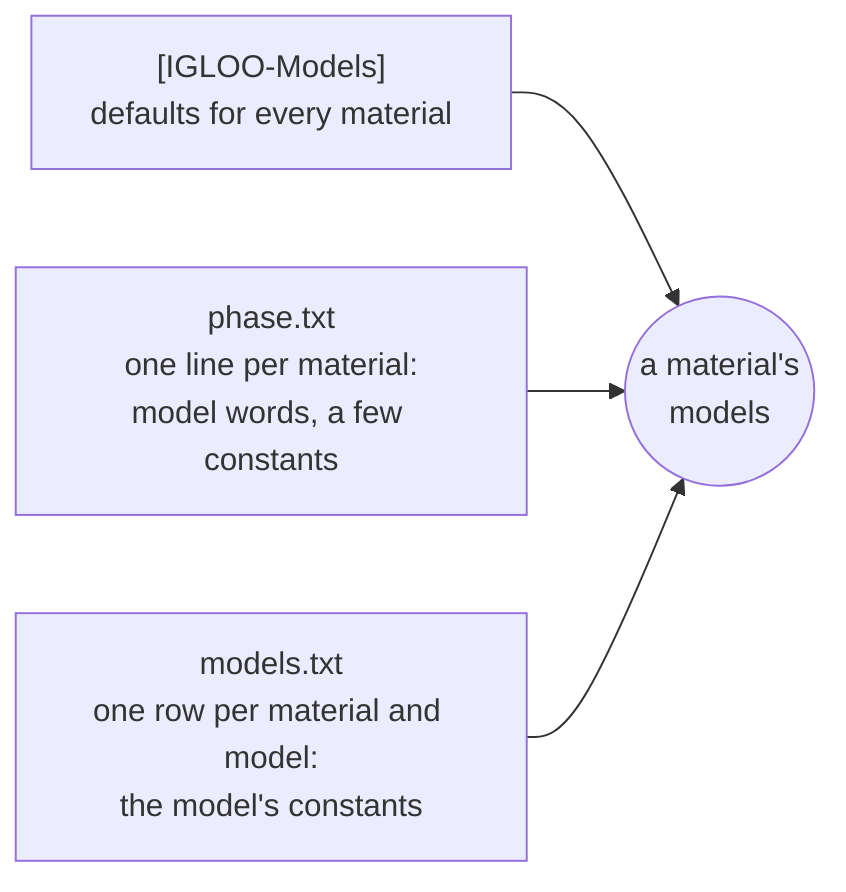

# Materials & Models

Each material picks its physics in three places:



- **`[IGLOO-Models]`** in `input.ini` sets the defaults: drag and heat for every material, and the default
  evaporation, breakup and burning models.
- **The phase file** (`INPUT/phase.txt`) has one line per material. A word on the line overrides the default for
  that material.
- **The models file** (`INPUT/models.txt`) holds the constants of the burning and breakup models.

ATLAS writes both files from `[GPB-Phase*]`. The physics of each model is in the [Theory Guide](../theory/index.md).

---

## The phase file

```text
condensed-dispersed
A   1 combustion=Beckstead carry=constant
OX  0 solidification=on T-melt=2327 h-fus=1.08949e6 cp-solid=1360
```

The first line names the phase type. Each further line is a material:

- its **name**;
- its number of **injection groups**: each group is one population of the material (one family), fed by its own
  copy of the inlet table ([Several families](boundary-conditions.md#several-families));
- any number of `key=value` words, in any order.

A material with **0 groups** is never injected: its parcels are only born, as the burnout residues of a drop that
carries it ([The burnout residue](../theory/combustion.md#the-burnout-residue)) or as the births a coupled solver adds
([Coupling](../development/coupling.md)). It keeps its own zone of `properties.dat` and its own output files. The
log says so: `0 groups -- its parcels are born only`.

The words a material line may carry:

| Word | Values | Section below |
| :--- | :--- | :--- |
| `evaporation` | `d2-law`, `CEM`, `CEM-B`, `ASM`, `TC`, `NoEvaporation` | [Evaporation](#evaporation) |
| `interface`, `liquid-conduction`, `boiling` | see below | [Evaporation](#evaporation) |
| `alpha-e`, `k-liq`, `mu-liq` | numbers | [Evaporation](#evaporation) |
| `breakup` | `Pilch-Erdman`, `Reitz-Diawakar`, `Reitz-KHRT`, `TAB`, `ETAB`, `NoBreakup` | [Breakup](#breakup) |
| `combustion` | `Beckstead`, `direct`, `none` | [Burning](#burning) |
| `carry` | `constant`, `Gallier21` | [A carried material](#a-carried-material) |
| `solidification` | `on`, `off` | [Solidification](#solidification) |
| `T-melt`, `h-fus`, `T-nuc`, `cp-solid`, `rho-solid` | numbers | [Solidification](#solidification) |

An unknown word, or a value that is not a number where one is expected, stops the run. The constants of the burning
and breakup models never go on the line: they belong to the models file.

---

## The models file

One row per material and kind of model:

```text
<material> <kind> <model> key=value key=value ...
```

The kinds are `combustion`, `carry` and `breakup`; `<model>` repeats the word on the material line (or `-`: the word
of the line, or of `[IGLOO-Models]`). Keys come in any order, a line starting with `#` is a comment, and every value
is one finite number (`carried` and `residue` take words).

```text
A combustion Beckstead K-burn=2.0e-6 n-burn=1.8 X-eff=0.5 T-ign=550 beta-part=0.3 q-comb=1000000
A carry constant share=0.2 yield=1.8894414971926081 carried=OX residue=on
```

Setup stops the run on:

- a row of an unknown kind, or a second row of the same kind for one material;
- a row whose model is not the one its material line names;
- a key the row's model does not read;
- a row for a material the phase file does not have;
- a value that is not one finite number (`NaN`, `Inf`, a value with `,` or `/`);
- a model constant in `[IGLOO-Models]` or on the material line instead of here.

---

## Drag and heat

Set once for every material, in `[IGLOO-Models]`:

| Key | Values | Theory |
| :--- | :--- | :--- |
| `drag` | `Stokes`, `Schlichting`, `Schiller-Naumann`, `Morsi-Alexander`, `Wen-Yu`, `Newton`, `Chang`, `Clift-Gauvin`, `Putnam`, `Henderson`, `Crowe`, `Hermsen`, `Carlson-Hoglund`, or `NoDrag` (no momentum exchange) | [Drag](../theory/drag.md) |
| `heat` | `Ranz-Marshall`, `Kavanau-Drake`, `JAXA1`, `JAXA2`, `JAXA3`, `JAXA4`, or `NoHeat` (no convective heat) | [Heat Transfer](../theory/heat.md) |

The radiative exchange is switched on by a material's emissivity ([Material Properties](properties.md)).

---

## Evaporation

| Key | Where | Values (default) | Meaning |
| :--- | :--- | :--- | :--- |
| `evaporation` | `[IGLOO-Models]`, line | `d2-law`, `CEM`, `CEM-B`, `ASM`, `TC` (absent: none) | the evaporation model |
| `interface` | `[IGLOO-Models]`, line | `VLE`, `LK` (`VLE`) | the surface state: equilibrium, or Langmuir–Knudsen non-equilibrium |
| `alpha-e` | line | number (1.0) | the accommodation coefficient of `LK` |
| `blowing` | `[IGLOO-Models]` | `none`, `LK` (`none`) | the Stefan-blowing reduction of the convective heat |
| `liquid-conduction` | `[IGLOO-Models]`, line | `ITC`, `P2T` (`ITC`) | a uniform temperature inside the drop, or a parabolic profile |
| `k-liq` | line | number [W/(m K)] | the liquid conductivity of `P2T`, when the table has no `Conductivity` column |
| `mu-liq` | line | number [Pa s] | the liquid viscosity of `P2T` on a material that does not break, when the table has no `Viscosity` column |
| `boiling` | `[IGLOO-Models]`, line | `clamp`, `ZGR` (`clamp`) | above the boiling point: cap the gas-side model, or the Zuo–Gomes–Rutland boiling branch |

The evaporation properties (latent heat, vapour molar mass, boiling point, ...) are in
[Material Properties](properties.md). Theory: [Evaporation](../theory/evaporation.md).

Setup stops the run on `interface = LK` with the d²-law (which does not use the surface state), and on `P2T` or
`ZGR` on a material that does not evaporate. `P2T` needs the conductivity (`k-liq` or the column) and, on a material
that does not break, the viscosity (`mu-liq` or the column); a breaking material uses its breakup viscosity and
refuses `mu-liq`.

---

## Breakup

`breakup` in `[IGLOO-Models]` is the default of every material; `breakup=<model>` on a material line overrides it.
The constants are optional rows of the models file, `<material> breakup <model> key=value ...`; a constant the row
does not give takes its default, and `<material> breakup <model>` alone is valid.

| Model | Row keys (default) |
| :--- | :--- |
| `Pilch-Erdman` | `Cd` (1.0), `B` (0.116) |
| `Reitz-Diawakar` | `WeBag` (6), `Cb` (π), `Cstrip` (0.5), `Cs` (20) |
| `Reitz-KHRT` | `B0` (0.61), `B1` (20), `Ctau` (1), `CRT` (0.1), `mShedLim` (0.03), `WeLimit` (6) |
| `TAB` | `Comega` (8), `Cmu` (5), `WeCrit` (6), `method` (2; 1 the chi-square law, 2 Rosin–Rammler), `n` (3.5) |
| `ETAB` | `k1` (0.2222), `k2` (0.2222), `WeCrit` (6), `WeTrans` (80), `Comega` (8), `Cmu` (5) |

`WeCrit` is the critical Weber number as written. TAB and ETAB each read their own `Comega`, `Cmu` and `WeCrit`. A
material whose row gives a constant prints its full set at setup. A breaking material needs its surface tension and
viscosity ([Material Properties](properties.md)). Theory: [Breakup](../theory/breakup.md).

Setup stops the run on a breakup row for a material with no breakup model, and on a breakup constant in
`[IGLOO-Models]` or on the material line.

---

## Burning

`combustion` in `[IGLOO-Models]` is the default of every injected material (never of a 0-group one);
`combustion=<model>` on a material line overrides it:

- `Beckstead`: the $d^n$ law of a burning metal drop;
- `direct`: the $d^2$ law of a drop that vaporises at its burning temperature and burns in the gas;
- `none` (the default).

Each burning material needs a `combustion` row. Theory: [Metal Combustion](../theory/combustion.md).

| Row | Key | Meaning | Default |
| :--- | :--- | :--- | :---: |
| `combustion Beckstead` | `K-burn` | burn-rate coefficient at `X-eff` = 1 [m^n/s] | required > 0 |
| | `n-burn` | diameter exponent $n$ | 1.8 |
| | `X-eff` | effective oxidizer mole fraction, (0, 1] | 1.0 |
| | `T-ign` | ignition temperature [K] | 2350 |
| | `beta-part` | the share of the heat of reaction that heats the drop | 0 |
| `combustion direct` | `T-burn` | burning temperature [K] | `boiling-temperature` of [Material Properties](properties.md), only at one atmosphere |
| both | `q-comb` | heat of combustion [J/kg] | required (0 allowed) |
| | `d-stop` | diameter [m] at which burning stops and the drop stays | 0 = none |
| | `d-burnout` | diameter [m] at which a burning drop is handed whole to the gas; to compare with ICE, give it in both decks, at about 0.1 of the injected diameter | 0 = the built-in burnout mass |

`direct` takes its latent heat from the material: the `Lv` column of `properties.dat` at the burning temperature,
else `Lv` of `[IGLOO-Properties]`. The log prints the value it uses.

Setup stops the run on:

- a burning material without a `combustion` row, or a row without `q-comb`;
- burning together with breakup or solidification on one material (burning with evaporation drops evaporation, with
  a warning);
- under `direct`: `q-comb` < 0; `d-stop` and `d-burnout` both set; no `T-burn` and no `boiling-temperature`; no
  `T-burn` with a `boiling-pressure` other than 101325 Pa; a burning temperature or latent heat that is not
  positive; the latent heat given both as a column and as a key, or neither;
- a `carry` word or row under `direct` (only `Beckstead` carries a material).

---

## A carried material

A `Beckstead` drop can keep part of what it burns into: an aluminium drop and its alumina cap, say. Put
`carry=<law>` on the burning material's line and a `carry` row in the models file:

| Row | Key | Meaning | Default |
| :--- | :--- | :--- | :---: |
| `carry constant` | `share` | the part of the product formed that the drop keeps, [0, 1] | 0 |
| `carry constant`, `carry Gallier21` | `yield` | kg of product formed per kg burnt (1.889441 for aluminium to alumina) | required > 0 |
| | `carried` | the carried material: the name of a 0-group line of the phase file | required |
| | `carried-0` | the carried mass fraction of the injected particle, [0, 1) | 0 |
| | `residue` | `on`: the carried material becomes a parcel of its own at burnout; `off`: it goes to the gas | `off` |
| | `d-residue` | the residue's diameter [m], with the mass flow kept; 0: one residue per drop | 0 |

`Gallier21` takes the share from Gallier's deposition law instead of `share`. Theory:
[A drop that carries what it forms](../theory/combustion.md#a-drop-that-carries-what-it-forms).

The carried material's own line has 0 groups, no burning, evaporation or breakup (under a global evaporation or
breakup word, write `evaporation=NoEvaporation`, `breakup=NoBreakup`), and may freeze with `solidification=on`.
Every `[IGLOO-Properties]` list holds a value for it too.

Setup stops the run on:

- a `carry` word without its row, or a word other than `constant` and `Gallier21`;
- `share` outside [0, 1], or `share` in a `Gallier21` row;
- a carried material without `yield` > 0, or without a 0-group `carried` line;
- `carried-0` outside [0, 1);
- `carried`, `yield`, `carried-0`, `residue=on` or `d-residue` > 0 on a material that carries nothing;
- a carried material that burns, evaporates or breaks up;
- a varying `Cp` or `Density` of either material, or a relative enthalpy table (a carrying material needs the
  absolute datum, [Material Properties](properties.md#the-enthalpy-datum));
- a negative `d-residue`, or one without `residue=on`.

---

## Solidification

A molten drop that freezes: `solidification=on` on its material line, with its constants beside it.

| Word | Meaning | Default |
| :--- | :--- | :---: |
| `solidification` | `on` turns freezing and melting on | `off` |
| `h-fus` | heat of fusion [J/kg] | required > 0 |
| `cp-solid` | heat capacity of the solid [J/(kg K)] | required > 0 |
| `T-melt` | melting temperature [K] | 2327 |
| `T-nuc` | nucleation temperature [K], below `T-melt` | 0.8 `T-melt` |
| `rho-solid` | density of the solid [kg/m³] | the liquid's |

The `Cp` and `Density` of `properties.dat` are the liquid's. A solidifying material may break up (while liquid) but
not evaporate or burn; setup stops the run on either, and on a negative `rho-solid`. Theory:
[Solidification](../theory/solidification.md).

For alumina the NIST-JANAF tables give $T_m$ = 2327 K, $h_\mathrm{fus}$ = 1.09 MJ/kg, $c_l$ = 1.89 kJ/(kg K) and
$c_s$ = 1.36 kJ/(kg K) at the melting point. The default `T-nuc` is a nominal undercooling: set it from data.
